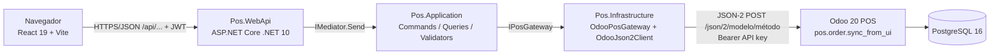

# NorthWindPOS

Punto de venta web integrado con el POS real de **Odoo 20 Community** (proyecto integrador de Tecnologías y Desarrollo Web).



- El navegador **solo** habla con la API .NET; la API key de Odoo nunca llega al navegador.
- La API **nunca** entra a PostgreSQL: todo pasa por Odoo (JSON-2). No se modifica Odoo, no hay módulos Python, no hay simuladores y no se usa `sale.order`.
- La venta se registra con `pos.order.sync_from_ui` (el mismo mecanismo del POS nativo), con un `uuid` por operación para no duplicar.

## Versiones

| Componente | Versión |
|---|---|
| .NET SDK | 10.0 (probado con 10.0.404), proyectos `net10.0` |
| ASP.NET Core JwtBearer | 10.0.14 · Swashbuckle 10.3.1 · FluentValidation 12.2.0 |
| xUnit | 2.9.3 · Microsoft.AspNetCore.Mvc.Testing 10.0.14 |
| Node.js / npm | 22 o superior (probado con Node 24.22 y npm 11.21) |
| React / React DOM | 19.3.1 · React Router 7.18.4 |
| TypeScript | 6.0.3 |
| Vite / Vitest | 8.3.5 / 5.0.5 · Testing Library React 16.3.3 · oxlint 1.89 |
| Odoo | 20.0 Community (imagen `odoo:20.0`) |
| PostgreSQL | 16 (imagen `postgres:16`, solo la usa Odoo) |

## Estructura

```
backend/src/Pos.Domain          Reglas propias (SaleDraft, SaleLine). Sin dependencias.
backend/src/Pos.Application     Casos de uso (Features/*: Commands, Queries, Handlers, Validators),
                                SimpleMediator, excepciones, DTOs, puertos (IPosGateway...),
                                RegisterApplicationServices.
backend/src/Pos.Infrastructure  Adaptadores: Odoo JSON-2, JWT, PBKDF2, cajeros configurados.
backend/src/Pos.WebApi          Controllers (solo llaman a _mediator.Send), filtro de errores, Program.
backend/tests/Pos.Application.Tests  P01–P06 + validators, mediator, login, RN08.
backend/tests/Pos.WebApi.Tests       Mapeo de errores HTTP, 401, CORS, 503 con Odoo caído.
backend/tests/Pos.Integration.Tests  P09 contra Odoo real (se salta si no hay RUN_ODOO_INTEGRATION=1).
frontend/src/{domain,application,infrastructure,presentation}  Ver frontend/README.md.
docs/                           Arquitectura, trazabilidad, evidencia P09, informe de integración.
```

## 1. Odoo

En la raíz del proyecto:

```powershell
docker compose -f docker-compose.odoo.yml up -d
```

Odoo queda en http://127.0.0.1:8070 (y en la IP de Tailscale configurada en `docker-compose.odoo.yml`, solo con Tailscale encendido). Base de datos: `odoo20_northwind`. Usuario inicial `admin` / `admin` (cámbiela antes de compartir el equipo).

En una instalación nueva, prepare los datos de caja (sesión abierta, método Cash, productos `NW-CAFE` y `NW-SAND`, API key):

```powershell
Get-Content -Raw scripts\bootstrap_odoo.py | docker exec -i northwind-odoo20-odoo-1 odoo shell -d odoo20_northwind --no-http --db_host=db --db_user=odoo --db_password=odoo
```

El script solo prepara el entorno con `odoo shell`; no es un módulo y no forma parte de la solución. Más detalle en `docs/ODOO_SETUP.md`.

## 2. API .NET

### Secretos (RNF01)

La API key de Odoo y la clave JWT **no se versionan**. Opción recomendada, `dotnet user-secrets` (se guardan fuera del repositorio):

```powershell
cd backend\src\Pos.WebApi
dotnet user-secrets set "Odoo:ApiKey" "<api key de Odoo>"
dotnet user-secrets set "Jwt:SigningKey" "<frase aleatoria de 32 caracteres o más>"
```

También se pueden usar variables de entorno (`Odoo__ApiKey`, `Jwt__SigningKey`, ver `.env.example`) o, solo en el equipo local, `appsettings.Development.json` (ignorado por Git; plantilla en `appsettings.Development.json.example`). Prioridad: variables de entorno > user-secrets > `appsettings.Development.json` > `appsettings.json`.

La API **no arranca** si falta `Jwt:SigningKey`, si tiene menos de 32 caracteres o si es el texto de ejemplo.

### Configuración no secreta

| Clave | Valor de este proyecto |
|---|---|
| `Odoo:BaseUrl` | `http://127.0.0.1:8070` |
| `Odoo:Database` | `odoo20_northwind` |
| `Odoo:PosConfigId` | `1` (Northwind Caja). Con 0 se usa la sesión abierta más reciente de cualquier POS |
| `Odoo:TimeoutSeconds` | 30–60 |
| `Odoo:MaxRetries` | 1 (reintentos solo de lecturas; la venta nunca se reenvía a ciegas) |
| `Cors:AllowedOrigins` | `http://127.0.0.1:5173`, `http://localhost:5173` |

Cajero de demostración (definido en la configuración local): `cajero` / `Cajero123!`.

### Arranque

```powershell
dotnet restore NorthWindPOS.slnx
dotnet run --project backend\src\Pos.WebApi --launch-profile http
```

La API escucha en http://localhost:5000. Swagger (solo en Development): http://localhost:5000/swagger. `backend/src/Pos.WebApi/Pos.WebApi.http` tiene peticiones de ejemplo.

## 3. Página web

```powershell
cd frontend
npm ci
npm run dev
```

Abra http://127.0.0.1:5173 e inicie sesión. Busque productos (se muestran precio sin impuestos y disponibilidad), agréguelos al carrito, ajuste cantidades (botones − / +1 o campo numérico) y pulse **Cobrar en efectivo**. El total del carrito es provisional y sin impuestos; el total cobrado lo confirma Odoo.

## Pruebas

```powershell
dotnet build NorthWindPOS.slnx        # 0 errores, 0 advertencias
dotnet test NorthWindPOS.slnx         # P01–P06 y API; P09 aparece como "Skipped"
cd frontend
npm test                              # P07, P08, login, casos de uso
npm run build
npm run lint
```

### P09 (integración real con Odoo)

Con Odoo levantado, la sesión `Northwind Caja/00001` abierta y los secretos configurados:

```powershell
$env:RUN_ODOO_INTEGRATION = "1"
$env:P09_EVIDENCE_DIR = "$PWD\docs\evidence\p09"
dotnet test backend\tests\Pos.Integration.Tests --logger "console;verbosity=detailed"
```

La prueba levanta la API en proceso, inicia sesión, busca productos, lee la sesión activa, vende 2 × Cafe Norte (id 3) + 1 × Sandwich Norte (id 4) en efectivo, lee la venta, la reenvía con el mismo `clientOperationId` (espera `replay: true` y la misma orden) y prueba dos POST simultáneos. Guarda las respuestas JSON en `P09_EVIDENCE_DIR` (sin JWT ni API key). Variables opcionales: `P09_API_URL` (usar una API ya levantada), `P09_USER`, `P09_PASSWORD`, `P09_PRODUCT_A`, `P09_PRODUCT_B`, `P09_SESSION_ID`, `P09_CASH_METHOD_ID`. Ver `docs/INTEGRATION_EVIDENCE.md`.

## Qué no se sube a Git

- `appsettings.Development.json` (API key, JWT y operadores reales), user-secrets, `.env`
- `bin/`, `obj/`, `node_modules/`, `dist/`, `.vs/`, `docker-compose.override.yml`

## Documentación

- `docs/ARQUITECTURA.md` — capas, flujo y diagrama
- `docs/ODOO_SETUP.md` — preparación de Odoo
- `docs/TRACEABILITY.md` — requisito → componente → prueba
- `docs/INTEGRATION_EVIDENCE.md` y `docs/evidence/` — P09
- `docs/INFORME_INTEGRACION.md` — informe breve de integración y contingencia
- `frontend/README.md` — arquitectura del frontend
