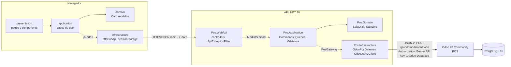

# Arquitectura NorthWindPOS

## Flujo de punta a punta



Versión en texto:

```
Navegador (React)  --/api/... JSON + JWT-->  Pos.WebApi  --IMediator-->  Pos.Application  --IPosGateway-->
Pos.Infrastructure  --JSON-2 (Bearer API key)-->  Odoo 20 POS  -->  PostgreSQL 16
```

- El frontend nunca llama a Odoo. .NET nunca accede a PostgreSQL. No se modifica Odoo ni se crean módulos.

## Backend (Clean Architecture, estilo CleanTeeth)

```
Pos.Domain          SaleDraft, SaleLine, DomainValidationException (RN01, RN02). Sin referencias.
    ↑
Pos.Application     Common/Mediator (IRequest, IRequestHandler, IMediator, SimpleMediator)
                    Common/Exceptions (NotFoundException, CustomValidationException)
                    Common (AppException + ErrorKind, SaleResultUncertainException,
                            SaleVerificationException, PosIntegrationException, SaleOperationLock)
                    Abstractions (IPosGateway, IOperatorRepository, IPasswordHasher, ITokenIssuer,
                                  IPosSessionService)
                    Features/
                      Auth/Commands/Login            LoginCommand + Handler + Validator
                      Products/Queries/SearchProducts
                      Sessions/Queries/GetActiveSession, GetOpenSessions
                      Sales/Commands/CreateSale      Command + Handler + Validator
                      Sales/Queries/GetSales, GetSaleById, GetSaleByOperationId
                      Sales/Common                   SaleVerifier (RN08), SaleSubmissionBuilder (RN03, RN06)
                    Models (DTOs de salida: SaleInfo, ProductInfo, PosSessionInfo...)
                    RegisterApplicationServices.cs (mediator, handlers, validators)
    ↑
Pos.Infrastructure  Odoo/OdooJson2Client (JSON-2, timeout, reintentos de lectura, logs sin secretos)
                    Odoo/OdooPosGateway (implementa IPosGateway)
                    Authentication (JWT, PBKDF2, cajeros configurados)
                    DependencyInjection/AddInfrastructure (solo adaptadores)
    ↑
Pos.WebApi          Controllers → _mediator.Send(...); ApiExceptionFilter; Program (CORS, JWT, Swagger en Development)
```

### Pipeline de un caso de uso

`Controller → IMediator.Send(command)` → `SimpleMediator` ejecuta los `IValidator<T>` (FluentValidation; si fallan lanza `CustomValidationException` → 400) → `IRequestHandler<T,R>.Handle` → DTO de salida.

### Mapeo de errores (ApiExceptionFilter)

| Excepción | HTTP | Código |
|---|---|---|
| `CustomValidationException` | 400 | código del primer error (`SALE_EMPTY`, `QUANTITY_INVALID`...), lista en `errors` |
| `AppException` Validation / Unauthorized / NotFound | 400 / 401 / 404 | `PRODUCT_NOT_VENDIBLE`, `AUTH_INVALID_CREDENTIALS`, ... |
| `NotFoundException` | 404 | `SALE_NOT_FOUND`, `POS_SESSION_NOT_FOUND` |
| `SaleVerificationException` | 409 | `SALE_NOT_VERIFIED` |
| `SaleResultUncertainException` | 504 | `SALE_RESULT_UNCERTAIN` (+ `operationId`) |
| `PosIntegrationException` Unavailable / NotConfigured | 503 | `ODOO_UNAVAILABLE` / `ODOO_NOT_CONFIGURED` |
| `PosIntegrationException` Timeout | 504 | `ODOO_TIMEOUT` |
| `PosIntegrationException` Authentication / Permission | 502 | `ODOO_AUTHENTICATION` / `ODOO_PERMISSION` |
| `PosIntegrationException` Rejected | 422 | `ODOO_REJECTED` |
| `PosIntegrationException` InvalidResponse / Unexpected | 502 | `ODOO_INVALID_RESPONSE` / `ODOO_ERROR` |
| Cualquier otra | 500 | `INTERNAL_ERROR` (sin detalles internos) |

## Integración con Odoo (JSON-2)

| Necesidad | Llamada |
|---|---|
| Sesión activa / abiertas | `pos.session.search_read` con `state = opened` (y `config_id = Odoo:PosConfigId` si está configurado) |
| Moneda y decimales | `pos.config.read` (`currency_id`) + `res.currency.read` (`decimal_places`) |
| Método de efectivo (RN05) | `pos.config.payment_method_ids` → `pos.payment.method.read`, se elige el de `type = cash` |
| Catálogo (RF02) | `product.product.search_read` con `sale_ok = true`, `available_in_pos = true` y búsqueda por `name` / `default_code` / `barcode`; campos `qty_available`, `is_storable`, `currency_id` si existen (`fields_get`) |
| Precios POS (RN06) | `product.template.get_product_info_pos` (precio con y sin impuestos para el `pos.config`) |
| Venta (RF05, RF06) | `pos.order.sync_from_ui` con `uuid`, `session_id`, `lines` y `payment_ids` (efectivo). Sin `write` manual de importes ni de `amount_paid` |
| Lectura de ventas (RF07) | `pos.order.search_read` + lecturas en lote de `pos.order.line`, `pos.payment` y `pos.payment.method` (4 llamadas en total, sin N+1) |
| Conciliación (RN07) | `pos.order.search_read` por `uuid` antes de enviar y después de un timeout o caída |

### Idempotencia y resultado incierto

1. El frontend genera `clientOperationId` y lo conserva hasta recibir 200.
2. El handler serializa en memoria las peticiones con el mismo id (doble clic) y busca la orden por `uuid`. Si existe y está pagada responde `replay: true` sin reenviar.
3. Si no existe, envía **una vez** con `sync_from_ui`. Ante timeout o caída de Odoo vuelve a buscar por `uuid`: si la orden aparece, se aplica la misma verificación RN08; si no aparece responde 504 `SALE_RESULT_UNCERTAIN` y el cajero reintenta con el mismo id (que vuelve a conciliar primero).
4. Solo se informa éxito con estado `paid`/`done` y `amount_paid >= amount_total` leídos de Odoo.

`Odoo:MaxRetries` aplica únicamente a lecturas (`search_read`, `read`, `fields_get`, `get_product_info_pos`); `sync_from_ui` nunca se reintenta automáticamente. Cada llamada se registra con modelo, método, estado HTTP, duración e intento; nunca cabeceras, cuerpos ni la API key.

## Frontend (Clean Architecture adaptada)

```
src/domain           modelos, Cart y funciones puras del carrito, formato y estados
src/application      puertos (PosApiPort, SessionStorePort), casos de uso (login, loadCatalog, checkout, loadSales)
src/infrastructure   httpPosApi (solo /api/...), browserSessionStore (JWT en sessionStorage), container
src/presentation     App, ServicesContext, pages (Login, POS, Ventas, Detalle), components (Cart, ProductCard, ...)
```

Flujo: Login JWT → sesión activa (o selector) → catálogo → carrito → cobro en efectivo → confirmación de Odoo o error claro (incierto con reintento por el mismo `clientOperationId`).

## Seguridad

- API key de Odoo y clave JWT por user-secrets o variables de entorno (`Odoo__ApiKey`, `Jwt__SigningKey`); `appsettings.Development.json` está en `.gitignore`.
- La API exige `Jwt:SigningKey` (≥ 32 caracteres) al arrancar.
- CORS restringido a `http://127.0.0.1:5173` y `http://localhost:5173` (configurable en `Cors:AllowedOrigins`).
- Swagger solo en Development. Login inválido → 401; endpoints sin token → 401.
- Odoo y la API corren en `localhost`/Tailscale (red privada), por eso se usa HTTP. Para exponerlos fuera de esa red hay que activar HTTPS (Tailscale Serve o un proxy inverso).
